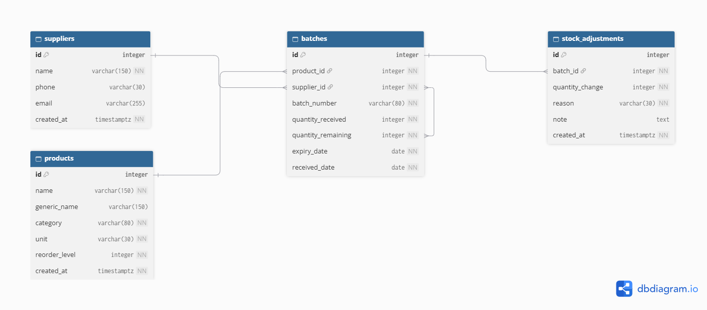

# ExpiryWatch API

A learning project focused on building a FastAPI backend for tracking product records, with future support for stock batches and expiry-date monitoring.

## Overview

ExpiryWatch is designed for owners of small pharmacies and patent medicine shops in Nigeria. The project addresses a common operational issue: products and stock items are often tracked informally, which can lead to expired items going unnoticed, causing financial waste and potential safety risks.

The system aims to provide a simple, reliable way to manage product information and, later, monitor stock movement, batch details, and expiry dates with minimal friction.

## Tech Stack

- Python 3.10+
- FastAPI
- SQLAlchemy
- Alembic
- PostgreSQL (running locally via Docker)

## Current Status

Week 1 — complete: product CRUD (create, list, get, update, delete), migration, seed data and sample requests. Suppliers, batches and stock adjustments are planned for Week 2 (see `docs/data-model.md`).

## Features

- Product creation, reading, updating, and deletion
- Local PostgreSQL setup for development
- Clean API structure using FastAPI and SQLAlchemy
- Future support for inventory batches, expiry tracking, and stock alerts

## Prerequisites

Before you begin, make sure you have:

- Python 3.10 or newer
- Docker installed and running

## Local Setup

1. Clone the repository and move into the project directory.
2. Copy `.env.example` to a new file named `.env`.
3. Set a strong local password for `POSTGRES_PASSWORD` and use the same value in `DATABASE_URL`.
4. Start the database container:

   ```bash
   docker compose up -d
   ```

5. Create and activate a virtual environment:

   ```bash
   python -m venv .venv
   ```

   On macOS/Linux:

   ```bash
   source .venv/bin/activate
   ```

   On Windows PowerShell:

   ```powershell
   .\.venv\Scripts\Activate.ps1
   ```

6. Install the project dependencies:

   ```bash
   pip install -r requirements.txt
   ```

7. Apply the database migrations:

   ```bash
   alembic upgrade head
   ```

8. (Optional) Load a few rows of dummy data. The script skips seeding if products already exist:

   ```bash
   python scripts/seed_products.py
   ```

9. Run the application:

   ```bash
   uvicorn app.main:app --reload
   ```

10. Open the interactive docs at <http://127.0.0.1:8000/docs>, or try the sample requests in `requests/product.http` (VS Code "REST Client" extension).

## API Overview

| Method | Path | Success |
| :--- | :--- | :--- |
| GET | `/health` | `200` |
| POST | `/products` | `201` |
| GET | `/products` | `200` |
| GET | `/products/{id}` | `200` |
| PUT | `/products/{id}` | `200` |
| DELETE | `/products/{id}` | `204` |

Full details are in `docs/api-spec.md`.

### Errors

Every error uses one format, and stack traces are never returned:

```json
{ "error": { "code": "PRODUCT_NOT_FOUND", "message": "Product 9999 not found" } }
```

Invalid input returns **400** (not FastAPI's default 422) with `code: "INVALID_INPUT"` and a `details` list of the failing fields. See `docs/design-decisions.md` (DEC-004, DEC-005).

## Environment and Security Notes

- The local PostgreSQL database is bound to `127.0.0.1` and is intended only for development.
- Keep your `.env` file private. `DATABASE_URL` has no default in the code, so the app will not start without it.
- In production, store credentials using your deployment platform's secret manager and keep the database on a private network rather than exposing local development settings.

## Documentation

See the `/docs` folder for the project concept, work plan, data model, and API specifications.

## Entity Relationship Diagram (ERD)



## Warning

This is a learning project. Use dummy data only. Never input real pharmacy stock records, personal customer details, or real passwords.
