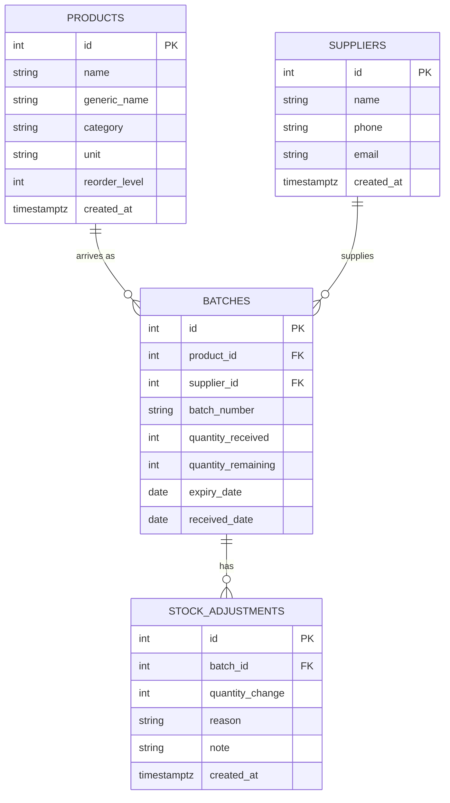

# ExpiryWatch API: Data Model

**Database:** PostgreSQL  
**Status:** Week 1 implements `products` only. `suppliers`, `batches` and `stock_adjustments` are designed here and implemented in Week 2.  
**Data policy:** dummy data only. No real personal, supplier or patient information.

---

## 1. Entities at a glance

| Entity | Purpose | Implemented in |
|---|---|---|
| `products` | The medicines/items the pharmacy sells (the catalogue) | **Week 1** |
| `suppliers` | Who the pharmacy buys stock from | Week 2 |
| `batches` | A delivery of one product from one supplier, with its own expiry date | Week 2 |
| `stock_adjustments` | An audit trail of every change to a batch's quantity | Week 2 |

---

## 2. Entity definitions

### 2.1 `products` (implemented in Week 1)

| Field | Type | Required? | Constraints / purpose |
|---|---|---|---|
| `id` | Integer | Yes | Primary key; generated by the database. |
| `name` | String(150) | Yes | Display name. Cannot be blank (trimmed length >= 1). |
| `generic_name` | String(150) | No | Optional generic/ingredient label. Dummy text only. |
| `category` | String(80) | Yes | Simple category label (e.g. "Pain relief"). |
| `unit` | String(30) | Yes | How stock is counted: `tablet`, `bottle`, `sachet`, `pack`. Keep values consistent. |
| `reorder_level` | Integer | Yes | Default `0`. Must be `>= 0`. |
| `created_at` | Timestamp with time zone | Yes | Set automatically on creation (server default `now()`). |

**Constraints**
- `PRIMARY KEY (id)`
- `NOT NULL` on `name`, `category`, `unit`, `reorder_level`, `created_at`
- `CHECK (reorder_level >= 0)`
- `CHECK (length(trim(name)) > 0)`

---

### 2.2 `suppliers` (planned for Week 2)

| Field | Type | Required? | Constraints / purpose |
|---|---|---|---|
| `id` | Integer | Yes | Primary key. |
| `name` | String(150) | Yes | Dummy supplier/business name. |
| `phone` | String(30) | No | Stored as **text**, not an integer (preserves leading zeros and `+`). Dummy values only. |
| `email` | String(254) | No | Dummy addresses, e.g. `supplier-1@example.test`. |
| `created_at` | Timestamp with time zone | Yes | Set automatically. |

---

### 2.3 `batches` (planned for Week 2)

| Field | Type | Required? | Constraints / purpose |
|---|---|---|---|
| `id` | Integer | Yes | Primary key. |
| `product_id` | Integer (FK) | Yes | References `products.id`. |
| `supplier_id` | Integer (FK) | Yes | References `suppliers.id`. |
| `batch_number` | String(60) | Yes | Batch identifier. **Unique per supplier** (see decision D4). |
| `quantity_received` | Integer | Yes | Must be `> 0`. |
| `quantity_remaining` | Integer | Yes | Starts equal to `quantity_received`; must never be negative. |
| `expiry_date` | Date | Yes | Belongs to the batch, not the product. |
| `received_date` | Date | Yes | Date the batch was received. |

**Constraints**
- `FOREIGN KEY (product_id) REFERENCES products(id) ON DELETE RESTRICT`
- `FOREIGN KEY (supplier_id) REFERENCES suppliers(id) ON DELETE RESTRICT`
- `UNIQUE (supplier_id, batch_number)`
- `CHECK (quantity_received > 0)`
- `CHECK (quantity_remaining >= 0)`
- **Planned index:** `expiry_date` (supports "expiring within N days" queries) and `product_id`.

---

### 2.4 `stock_adjustments` (planned for Week 2)

| Field | Type | Required? | Constraints / purpose |
|---|---|---|---|
| `id` | Integer | Yes | Primary key. |
| `batch_id` | Integer (FK) | Yes | References `batches.id`. |
| `quantity_change` | Integer | Yes | Non-zero. Negative removes stock, positive adds/corrects. |
| `reason` | String with allowed values | Yes | One of `sold`, `damaged`, `expired`, `correction`. |
| `note` | String(255) | No | Optional explanation. No personal or confidential information. |
| `created_at` | Timestamp with time zone | Yes | Set automatically. |

**Constraints**
- `FOREIGN KEY (batch_id) REFERENCES batches(id) ON DELETE RESTRICT`
- `CHECK (quantity_change <> 0)`
- `CHECK (reason IN ('sold','damaged','expired','correction'))`
- `CHECK (reason = 'correction' OR quantity_change < 0)` (sold/damaged/expired must remove stock)

---

## 3. Relationships

| Relationship | Cardinality | Notes |
|---|---|---|
| product -> batches | One-to-many | A product can arrive in many batches. |
| supplier -> batches | One-to-many | A supplier can supply many batches. |
| batch -> stock_adjustments | One-to-many | A batch can have many adjustments over its life. |
| batch -> product, supplier | Many-to-one | Each batch belongs to exactly one product and one supplier. |
| stock_adjustment -> batch | Many-to-one | Each adjustment belongs to exactly one batch. |

`products` and `suppliers` are linked many-to-many **through** `batches`.

### ERD (Mermaid)

---

## 4. Stock rules

1. **Expiry lives on the batch.** The same product arrives in different batches with different expiry dates.
2. **Starting quantity.** When a batch is received, `quantity_remaining = quantity_received`.
3. **No silent overwrites.** Once adjustments exist, every stock change creates a `stock_adjustments` row. `quantity_remaining` is changed only as a result of an adjustment.
4. **Never negative.** An adjustment that would take `quantity_remaining` below 0 is rejected.
5. **Direction of change.** `sold`, `damaged` and `expired` use a negative `quantity_change`. `correction` may be positive or negative.
6. **Referenced records cannot be deleted.** A product, supplier or batch that is referenced by other records is protected (`ON DELETE RESTRICT`); the API will return a clear conflict error (409) instead of leaving broken relationships.
7. **Integer quantities only.** Counted units are whole numbers. If fractional quantities are needed later, the type will be redesigned and documented rather than mixed.

> Batch and adjustment logic is **not** implemented in Week 1.

---

## 5. Design decisions

| # | Decision | Reason |
|---|---|---|
| D1 | PostgreSQL (relational) | The data is relational and integrity matters (a batch cannot exist without a product). |
| D2 | Integer auto-increment IDs | Simple for a first project; consistent across all tables. |
| D3 | Expiry on `batches`, not `products` | The same medicine arrives with different expiry dates. |
| D4 | `batch_number` unique per supplier | Different suppliers may reuse the same number; the same supplier should not. |
| D5 | Adjustments are a separate table | Gives an audit trail instead of overwriting quantities. |
| D6 | `ON DELETE RESTRICT` everywhere | Safest default; prevents orphaned data. |
| D7 | `phone` stored as text | Integers drop leading zeros and cannot hold `+`. |
| D8 | Minimal product fields | Each extra field adds validation and documentation work. |
| D9 | Plural table names, `snake_case` fields | Consistent naming across the database and API. |

## 6. Open questions (to revisit)

- Should `products.name` + `unit` be unique to prevent duplicates? (Likely a Week 2 edge case.)
- Should a batch be allowed with `expiry_date` earlier than `received_date`? (Currently no rule; decide in Week 2 validation.)